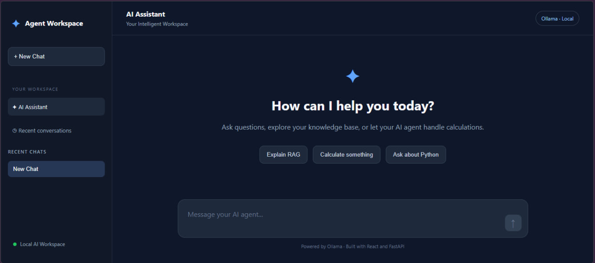
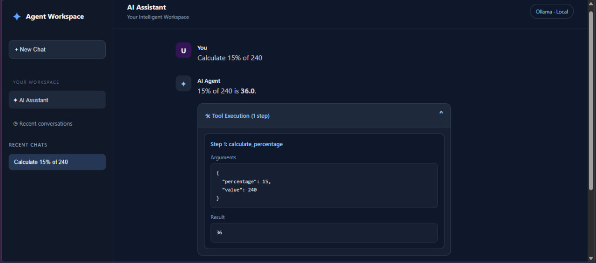
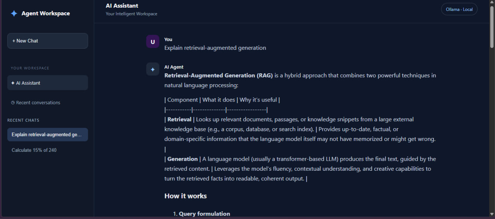

# Full-Stack AI Agent with RAG and Tool Calling

**Projects 5 & 6 | AI Agent API + AI Agent Web Application**

**Tech Stack:** Python, FastAPI, React, TypeScript, Vite, GroqCloud, Ollama, RAG, Upstash Redis, Docker, Vercel

**Live Demo:** https://project-06-ai-agent-web-app-murex.vercel.app

**Backend API:** https://project-05-ai-agent-api.vercel.app/docs

**GitHub Repositories:**
- Backend: https://github.com/Derobm-code/project_04_ai_agent_api
- Frontend: https://github.com/Derobm-code/project_06_ai_agent_web_app

---

## Project Overview

I built and deployed a full-stack AI agent application that can understand user requests, execute Python tools, retrieve information from a knowledge base, and display results through an interactive web interface.

My goal was to go beyond building a basic chatbot. I wanted to understand how AI agents work behind the scenes, particularly how a large language model can decide when to use a tool, pass arguments to it, process the result, and generate a final response.

I also wanted to gain practical experience connecting a Python backend to a modern React frontend and deploying both as a publicly accessible application.

## The Problem I Wanted to Solve

A traditional chatbot mainly generates text based on its training data. However, some tasks require accurate calculations, access to specific documents, or interaction with external functions.

I wanted to build an application that could handle these tasks by combining an LLM with tools and knowledge-base retrieval.

The application needed to:

- Understand natural-language questions.
- Select and execute the appropriate Python tools.
- Retrieve relevant information from a local knowledge base.
- Display the agent's answer and tool execution steps.
- Work through a publicly deployed web interface.
- Protect the hosted AI service from excessive requests.

## My Solution

I divided the project into two connected applications.

**Project 5 — AI Agent API:** I developed the backend using Python and FastAPI. It handles incoming requests, communicates with the language model, executes tools, retrieves knowledge-base content, and returns structured responses.

**Project 6 — AI Agent Web App:** I developed the frontend using React, TypeScript, and Vite. It provides a chat interface where users can interact with the agent and inspect the tools it executes.

I deployed both applications separately on Vercel and connected them through a REST API.

## System Architecture

The application follows this workflow:

**User → React Frontend → FastAPI Backend → AI Agent → Python Tools / Knowledge Base → API Response → Frontend**

When a user sends a message, the frontend sends a POST request to the `/chat` endpoint.

The backend checks the request limit, forwards the message to the AI agent, and processes any tool calls requested by the model.

Once the agent finishes, the API returns a structured response containing the final answer and the tool execution trace.

The frontend then displays both the answer and the execution details.

## Key Features I Implemented

### 1. AI-Powered Tool Calling

I implemented seven Python tools, including tools for arithmetic calculations, percentage calculations, date and time retrieval, and knowledge-base search.

Instead of manually selecting a tool in the frontend, I let the language model determine which tool to call based on the user's request.

For example, when a user asks:

*Calculate 15% of 240.*

The agent selects the `calculate_percentage` tool, passes the required arguments, and returns the calculated result of 36.

### 2. Retrieval-Augmented Generation (RAG)

I implemented RAG so the agent could answer questions using my own knowledge-base documents.

For local development, I used Sentence Transformers with the `all-MiniLM-L6-v2` model to generate semantic embeddings.

For cloud deployment, I implemented a lightweight TF-IDF retrieval approach that works without loading large machine-learning dependencies.

This allowed me to keep the deployed backend lightweight while preserving knowledge-base search functionality.

### 3. Local and Cloud AI Support

During development, I used Ollama with a local language model.

For the public application, I integrated GroqCloud using the `openai/gpt-oss-20b` model.

I structured the backend so it could select the AI provider through configuration rather than requiring a completely separate API.

This gave me experience working with both locally hosted and cloud-hosted language models.

### 4. Interactive React Interface

I built a responsive chat interface using React and TypeScript.

Users can submit questions, read the agent's responses, and expand the tool execution details to understand how the result was produced.

I wanted the interface to show that the application was performing real tool execution rather than simply generating text.

### 5. API Rate Limiting

Because the public application uses a hosted AI service with usage limits, I added request protection using Upstash Redis.

The backend tracks requests and limits usage to 10 requests per IP address within the configured hourly window.

When a user exceeds the limit, the API returns HTTP `429`.

This helped me understand why production APIs need usage controls, even when the application is relatively small.

## Technical Challenges I Solved

### Deploying a Local AI Agent to the Cloud

My original agent depended on Ollama and local machine-learning libraries.

Those dependencies were not suitable for the lightweight serverless deployment I wanted.

I solved this by integrating GroqCloud for hosted inference and implementing a separate, lightweight retrieval path for the deployed knowledge base.

### Connecting the Frontend and Backend

Because the frontend and backend were deployed as separate Vercel projects, I encountered API configuration and CORS issues.

I resolved these by configuring the frontend API URL through environment variables and explicitly allowing the frontend origin in FastAPI's CORS middleware.

### Protecting the Public API

After integrating Upstash Redis, I encountered HTTP `503` errors caused by unsuccessful Redis authentication.

I tested the Redis REST API directly, corrected the configuration, and verified that the application could communicate with Upstash.

I also investigated backend HTTP `500` errors using API testing and Vercel logs.

These issues gave me practical experience debugging a deployed full-stack application.

## Testing and Verification

Before completing the project, I tested the deployed application end to end.

I verified that:

- The FastAPI `/chat` endpoint responds successfully.
- The React frontend communicates with the deployed backend.
- The AI agent executes calculation tools and returns correct results.
- Knowledge-base questions trigger the `search_knowledge_base` tool.
- The frontend displays the tool execution trace.
- Upstash rate limiting returns HTTP `429` when the configured request limit is exceeded.

## What I Learned

This project helped me strengthen my understanding of full-stack development and AI application engineering.

I gained practical experience with FastAPI endpoint design, React and TypeScript integration, LLM function calling, RAG, environment-variable management, serverless deployment, CORS, API security controls, and production debugging.

One of the biggest lessons was that building an AI agent is only one part of the challenge. Making the application accessible, reliable, and usable through a public interface requires additional engineering work.

## Final Result

I successfully built and deployed a working full-stack AI agent application that combines conversational AI, Python tool execution, knowledge-base retrieval, and a responsive web interface.

The project demonstrates my ability to connect AI capabilities with real application functionality, develop both frontend and backend components, and troubleshoot deployment issues.

It also provides a foundation for future projects involving more advanced AI agents, external APIs, authentication, and larger knowledge bases.

**Live Application:** https://project-06-ai-agent-web-app-murex.vercel.app

## Application Screenshots

### Chat Interface

### Tool Execution

### Knowledge Base Retrieval

